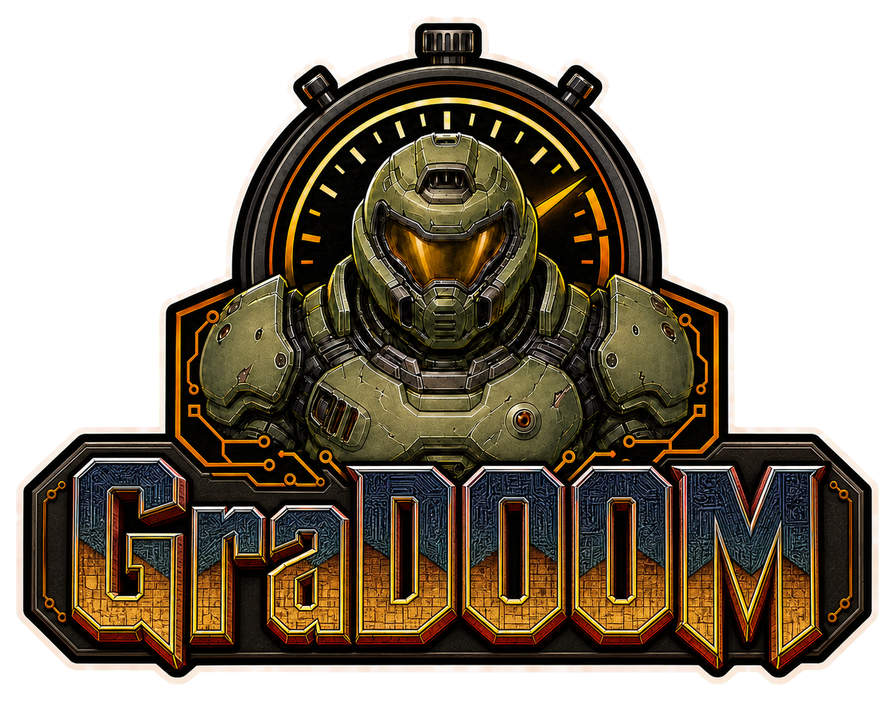

<p align="center">
  
  <br />
  <!-- repo-tagline:start -->
  <strong>🔥 Train Stronger Doom Policies, Faster 🔥</strong>
  <!-- repo-tagline:end -->
</p>

GraDOOM is a Torch-native Doom environment and policy training system for
reinforcement-learning researchers. Its batched simulation, observations,
rewards, and learning stay on the GPU during steady-state training.

## Get started

Use Python 3.11 or later, uv, and an NVIDIA GPU for training. Supply a
compatible Doom II or Freedoom Phase 2 IWAD.

```bash
uv add env-gradoom-turbo-torch
```

Follow the [quickstart](https://github.com/tsilva/env-GraDOOM-turbo-torch/blob/main/docs/quickstart.md)
to create vector lanes, step the environment, or train and evaluate a policy.

- [Architecture](https://github.com/tsilva/env-GraDOOM-turbo-torch/blob/main/docs/architecture.md)
- [Deathmatch parity](https://github.com/tsilva/env-GraDOOM-turbo-torch/blob/main/docs/deathmatch-parity.md)
- [Training optimization](https://github.com/tsilva/env-GraDOOM-turbo-torch/blob/main/docs/training-optimization.md)

## License

[MIT License](https://github.com/tsilva/env-GraDOOM-turbo-torch/blob/main/LICENSE).
